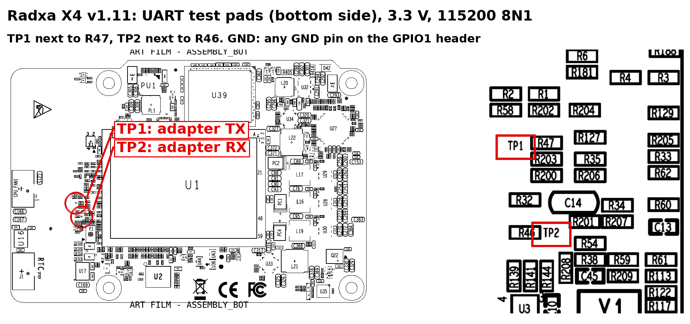
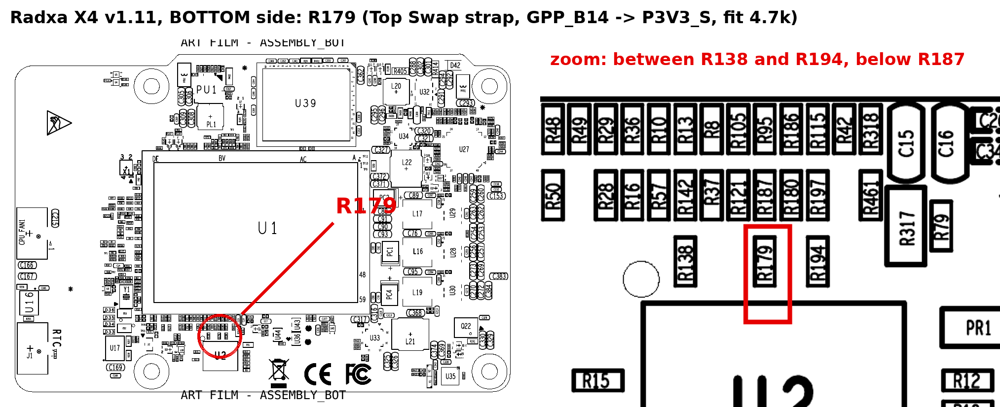

# Flashing (Radxa X4)

Flash `bios-region.bin` with Intel's `Fpt.efi`. It holds only the BIOS region, so the descriptor and ME stay stock. **Never write `coreboot.rom` with Fpt.**

| If a build doesn't boot | Fix it with |
|---|---|
| A debug build whose bootblock runs | [UART flash mode](#uart-flash-mode) |
| Any build | [Recovery](#recovery) |
| Nothing else works | An SPI programmer: a clip on the flash chip (Winbond W25Q128JV, 3.3 V). Write back your backup. |

## Flash with Fpt

Copy these files to a FAT32 USB stick. Radxa's files come from its [V007 zip](https://dl.radxa.com/x/x4/Radxa_X4_BIOS_V007.zip); don't copy the zip's `.nsh` scripts. Check the build first with `sha256sum -c SHA256SUMS`.

| File | From | To |
|---|---|---|
| `EFI/BOOT/BOOTX64.efi` (the EFI shell) | the V007 zip | `EFI/BOOT/` |
| `EFI/Fpt.efi` | the V007 zip | `EFI/` |
| `bios-region.bin`, `backup.nsh`, `install.nsh` | the build | `EFI/` |

1. Boot the stick. From the stock BIOS: turn Secure Boot off in setup (Del), then pick the stick with F7. From coreboot: press F2 and use the boot manager.
2. In the EFI shell run `fs0:`, `cd EFI`, then `backup.nsh` before the first install, then `install.nsh`. If the stick isn't `fs0:`, `map` lists the disks. Don't cut power until the script prints "Done".
3. Unplug the power, plug it back in and power on. Setup is back to its defaults.

`backup.nsh` saves the whole flash as `backup1.bin` and `backup2.bin`. Copy them off the stick and keep them: their sha256 must match.

## UART flash mode

A debug build's bootblock can reflash the rest of coreboot over UART, before anything else loads. Setup settings are kept.

**Wiring:** a 3.3 V USB-UART adapter at 115200 8N1 (a Raspberry Pi Debug Probe needs firmware v2.3.1 or newer). TX goes to TP1, RX to TP2, and GND to any GND pin on the GPIO1 header.



With the board off, run this, then power on:
```sh
python3 scripts/x4_uart_flash.py output/<build>/coreboot.rom --log boot.log
```
If it stops with an error, don't power off: run it again. For an adapter other than the Debug Probe, add `--port /dev/serial/by-id/<adapter>`.

The new build's bootblock must match the board's, or the tool refuses. Build it with `make DEBUG=1 KERNELVERSION=<version>`, where `<version>` comes from the board's boot log line `coreboot-<version> … bootblock starting`. Otherwise flash with Fpt or from recovery.

## Recovery

Every build carries a recovery bootblock that only runs UART flash mode. It can rewrite everything except the descriptor, the ME and itself, so it fixes production builds and broken bootblocks.

**Enter it** in one of two ways:
- **From a debug build:** run `python3 scripts/x4_uart_flash.py output/<build>/coreboot.rom --enter-recovery`, then power on.
- **From any build:** with the power unplugged, fit a 4.7 kΩ resistor on **R179**, on the bottom side between R138 and R194. Not R187 above it, and never a solder bridge. This way is untested with this recovery block.



**Flash and leave:**
```sh
python3 scripts/x4_uart_flash.py output/<build>/coreboot.rom --write-protected --leave-recovery --log boot.log
```
If a run stops part way, run it again: the board stays in recovery until a run completes. With R179 fitted, unplug the power and remove it afterwards. `--help` lists the other options.

Left alone, recovery boots normally after 10 minutes, unless it wrote flash or R179 is fitted.

**If recovery doesn't start** after `--enter-recovery`: unplug the 12 V, the coin cell at J1, the UART adapter's USB and any USB or HDMI device. Wait 60 s (5 minutes if that fails), then reconnect. This clears Top Swap and the clock; setup settings stay. Don't fit R179 for this: it holds Top Swap on.
